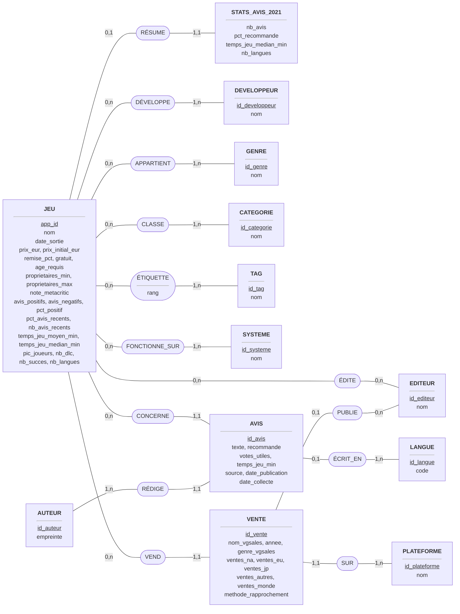
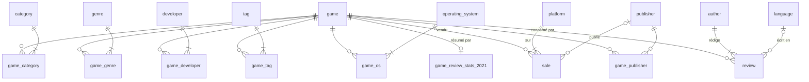

# Modélisation Merise de la base GameScope (C4)

Démarche Merise en trois niveaux :

| Niveau | Question | Livrable |
|---|---|---|
| **Conceptuel** (MCD) | *Quelles* données, et quels liens entre elles ? Indépendant de toute technologie. | entités, associations, cardinalités |
| **Logique** (MLD) | *Comment* les organiser en tables relationnelles ? | tables, clés primaires et étrangères |
| **Physique** (MPD) | *Comment* les implémenter dans le SGBD choisi ? | script SQL PostgreSQL : types, contraintes, index |

## 1. Description des données utiles

Données issues du jeu de données final (`data/clean/`, voir C3). Champs principaux :

| Donnée | Description | Type | Exemple | Source |
|---|---|---|---|---|
| app_id | Identifiant Steam du jeu | entier | 292030 | toutes |
| nom | Nom officiel | texte ≤ 255 | The Witcher 3: Wild Hunt | API Steam |
| date_sortie | Date de sortie sur Steam | date | 2015-05-18 | API Steam |
| prix_eur | Prix actuel en France | décimal | 29.99 | API Steam / scraping |
| gratuit | Free-to-play | booléen | false | calculé |
| proprietaires_min / max | Fourchette de propriétaires | entier | 20 000 000 / 50 000 000 | SteamSpy |
| note_metacritic | Note presse (1–100) | entier | 93 | API Steam / base partenaire |
| avis_positifs / negatifs | Avis Steam cumulés | entier | 873 011 | SteamSpy |
| pct_avis_recents | % d'avis positifs sur 30 jours | entier 0–100 | 81 | scraping |
| temps_jeu_median_min | Temps de jeu médian | minutes | 4 711 | SteamSpy |
| genre, catégorie, tag, développeur, éditeur, système | Référentiels n,n | texte | RPG / Open World / CD PROJEKT RED | API, scraping |
| texte_avis, recommande, date_publication | Avis d'un joueur | texte, booléen, horodatage | « One of the best RPG… » | API Steam / big data |
| empreinte_auteur | Auteur pseudonymisé (SHA-256 salé du steamid) | 64 caractères hexadécimaux | 5ff8c10a… | calculé |
| langue | Langue de l'avis | code BCP 47 | en, zh-Hans | API Steam |
| ventes_na / eu / jp / autres / monde | Ventes physiques par région | unités | 7 010 000 | vgsales |
| plateforme | Console ou PC des ventes | texte | PlayStation 3 | vgsales |
| email, role (utilisateur API) | Compte d'accès à l'API | texte | analyste@studio.fr | API GameScope (C5) |

**Règles de gestion** (d'où découlent les cardinalités) :

1. Un jeu peut avoir 0 à n développeurs, éditeurs, genres, catégories, tags et systèmes.
   Un élément de référentiel n'existe que s'il est lié à au moins 1 jeu. Exception :
   l'éditeur, qui peut n'apparaître que dans les ventes.
2. Un tag est attribué à un jeu avec un **rang** (1 = le plus voté) : c'est une
   propriété du **lien**, pas du jeu ni du tag.
3. Un avis concerne exactement 1 jeu et est rédigé par exactement 1 auteur. Un jeu
   peut n'avoir aucun avis collecté.
4. Un avis est écrit dans 0 ou 1 langue connue (une langue hors référentiel reste inconnue).
5. Une ligne de vente concerne exactement 1 jeu et 1 plateforme, et 0 ou 1 éditeur
   (éditeur « Unknown » écarté au C3).
6. Un jeu a 0 ou 1 jeu de statistiques d'avis 2021 (seuls ~230 jeux sont dans le
   dataset big data).
7. Un auteur sans aucun avis n'a plus de raison d'être conservé (RGPD) : un auteur
   a donc de 1 à n avis.

## 2. Modèle Conceptuel des Données (MCD)

**Définition :** le MCD représente les **entités** (objets du domaine, identifiés
par un identifiant souligné), les **associations** entre elles, et leurs
**cardinalités** `(min, max)`. Celles-ci se lisent depuis l'entité : « un JEU est
CONCERNÉ par **0 à n** AVIS ». Il ne présuppose aucune technologie.



Entités hors domaine métier, sans association (utilisées par l'API et la conformité) :

- **UTILISATEUR_API** (<u>id_utilisateur</u>, email, empreinte_mdp, role, date_creation, derniere_connexion)
- **JOURNAL_RGPD** (<u>id_journal</u>, date_execution, action, table, nb_lignes, detail)

**Choix de modélisation :**
- **VENTE est une entité** et non une association porteuse JEU–PLATEFORME : un même
  couple (jeu, plateforme) peut avoir plusieurs lignes. Exemple : *Need for Speed:
  Most Wanted* existe en version 2005 et 2012 sur Xbox 360.
- **AUTEUR est une entité distincte d'AVIS** : elle porte la donnée personnelle
  (l'empreinte) à un seul endroit, ce qui rend l'effacement d'une personne simple et complet.
- **STATS_AVIS_2021** est séparée de JEU (cardinalité 0,1) : ces statistiques ne
  concernent que ~12 % des jeux et proviennent d'une source distincte.
- Le **rang** du tag est porté par l'association ÉTIQUETTE (règle de gestion 2).

## 3. Modèle Logique des Données (MLD)

**Définition :** le MLD traduit le MCD en **tables relationnelles** selon des règles
de passage systématiques :

| Cas dans le MCD | Traduction dans le MLD |
|---|---|
| Entité | Table, l'identifiant devient la clé primaire |
| Association (x,1)–(x,n) | La clé de l'entité côté n migre en **clé étrangère** côté 1 (ex. `review.app_id`) |
| Association (x,n)–(x,n) | **Table d'association** dont la clé primaire est composée des deux clés (ex. `game_tag`) ; ses attributs (rang) y sont placés |
| Association (0,1)–(1,1) | La table côté (1,1) reprend la clé de l'autre comme clé primaire **et** étrangère (`game_review_stats_2021.app_id`) |

Notation : clé primaire <u>soulignée</u>, clé étrangère précédée de `#`.

```
game (app_id, name, release_date, price_eur, price_initial_eur, discount_pct, is_free,
      required_age, owners_min, owners_max, metacritic_score, positive_reviews,
      negative_reviews, pct_positive, recent_review_pct, recent_review_count,
      recent_review_desc, avg_playtime_min, median_playtime_min, peak_ccu, dlc_count,
      achievements, recommendations, languages_count, updated_at)
game_review_stats_2021 (#app_id, nb_reviews, pct_recommended, median_playtime_min, nb_languages)

developer        (developer_id, name)        game_developer (#app_id, #developer_id)
publisher        (publisher_id, name)        game_publisher (#app_id, #publisher_id)
genre            (genre_id, name)            game_genre     (#app_id, #genre_id)
category         (category_id, name)         game_category  (#app_id, #category_id)
tag              (tag_id, name)              game_tag       (#app_id, #tag_id, tag_rank)
operating_system (os_id, name)               game_os        (#app_id, #os_id)

language (language_id, code)
author   (author_id, author_hash)
review   (review_id, #app_id, #author_id, #language_id, review_text, recommended,
          votes_helpful, author_playtime_min, source, created_at, collected_at)

platform (platform_id, name)
sale     (sale_id, #app_id, #platform_id, #publisher_id, vgsales_name, release_year,
          vgsales_genre, sales_na_units, sales_eu_units, sales_jp_units,
          sales_other_units, sales_global_units, match_method)

api_user (user_id, email, password_hash, role, created_at, last_login_at)
rgpd_log (log_id, executed_at, action, table_name, rows_affected, detail)
```

Clés primaires : `app_id`, `review_id`, `sale_id`, `user_id`, `log_id` et les `*_id`
des référentiels. Les tables d'association ont une clé composée (`app_id`, `*_id`).



### Optimisation de la mémoire

Les types sont choisis au plus juste d'après les valeurs réelles mesurées :

| Choix | Alternative | Gain |
|---|---|---|
| `author_id INTEGER` (4 octets) dans `review`, le hash étant stocké une seule fois dans `author` | répéter `author_hash CHAR(64)` (65 octets) dans chaque avis | 61 octets × 85 791 avis ≈ **5,2 Mo** dans `review` et son index |
| `language_id SMALLINT` (2 octets) + référentiel de 30 langues | `VARCHAR` répété (3 à 8 octets) | référentiel normalisé, codes garantis cohérents |
| `SMALLINT` (2 octets) pour les notes, pourcentages, âges, années, nombres de langues | `INTEGER` (4 octets) | moitié moins d'espace, bornes vérifiées par `CHECK` |
| `SMALLSERIAL` pour les petits référentiels (24 genres, 413 tags, 65 catégories) | `SERIAL` | les tables d'association (37 755 liens jeu–tag) stockent des clés de 2 octets |
| `NUMERIC(7,2)` pour les prix | `FLOAT` | pas d'erreur d'arrondi sur des montants (0,1 + 0,2 ≠ 0,3 en flottant) |
| `INTEGER` pour les ventes en unités (max 21 M < 2,1 milliards) | `BIGINT` | 4 octets économisés par colonne de ventes |
| `BIGINT` pour `review_id` | `INTEGER` | **précaution** : les identifiants Steam atteignent déjà 238 millions et croissent d'environ 30 millions par an. `INTEGER` (2,1 milliards max) serait saturé à terme |
| Table `game_review_stats_2021` séparée | 4 colonnes presque toujours NULL dans `game` | modèle plus clair (le gain mémoire est faible, PostgreSQL stockant les NULL dans un bitmap) |

Taille mesurée de la base après import : **~170 Mo**, dont 114 Mo pour `review` (le texte
des avis est compressé automatiquement par TOAST au-delà de 2 Ko).

## 4. Modèle Physique des Données (MPD)

**Définition :** le MPD est l'implémentation du MLD dans un SGBD précis. Il fixe les
types exacts, les contraintes d'intégrité, les index et les droits d'accès.

Script : [`database/init/01_schema.sql`](../database/init/01_schema.sql) (tables,
contraintes, index) et [`database/init/02_roles.sh`](../database/init/02_roles.sh)
(rôles d'accès).

| Mécanisme | Mise en œuvre | Rôle |
|---|---|---|
| Clés primaires | `PRIMARY KEY` | unicité, index automatique |
| Intégrité référentielle | `REFERENCES ... ON DELETE CASCADE` | un avis ne peut pas pointer vers un jeu inexistant. Supprimer un auteur supprime ses avis (RGPD). |
| Contraintes de domaine | `CHECK (metacritic_score BETWEEN 1 AND 100)`, `CHECK (source IN (...))` | rejet des valeurs aberrantes à l'insertion |
| Unicité métier | `UNIQUE NULLS NOT DISTINCT (app_id, platform_id, vgsales_name, release_year)` | import idempotent des ventes, même avec une année manquante (PostgreSQL ≥ 15) |
| Index secondaires | clés étrangères, accès inverse des associations, `release_date`, `collected_at` | filtres de l'API, purge RGPD |
| Rôles | `gamescope_api`, `gamescope_analyst` | moindre privilège (voir `database/README.md`) |

## 5. Tests

| Test | Résultat |
|---|---|
| Création du MPD dans un conteneur PostgreSQL 17 vierge | 21 tables, 2 rôles, **aucune erreur** |
| Import du jeu de données | 1 982 jeux, 85 791 avis, 76 288 auteurs, 719 ventes, 37 755 liens jeu–tag |
| Import relancé deux fois | mêmes comptes, aucun doublon (idempotence) |
| Erreur en cours d'import | **rollback** complet, base inchangée |
| Contraintes `CHECK` | ont rejeté une valeur corrompue du dataset source (4 398 046 511 106 votes sur un avis), qui a donné lieu à une nouvelle règle de nettoyage au C3 |
| Rôle analyste sur `api_user` | `permission denied` (attendu) |
| Procédure de tri RGPD | 3 tests automatisés (`tests/test_rgpd.py`) |

Exemple de requête de vérification (jointures sur le modèle) :

```sql
SELECT ge.name AS genre, count(*) AS nb_jeux,
       round(avg(g.metacritic_score), 1) AS metacritic_moyen
FROM game g
JOIN game_genre gg USING (app_id)
JOIN genre ge USING (genre_id)
GROUP BY ge.name
ORDER BY nb_jeux DESC
LIMIT 5;
```
